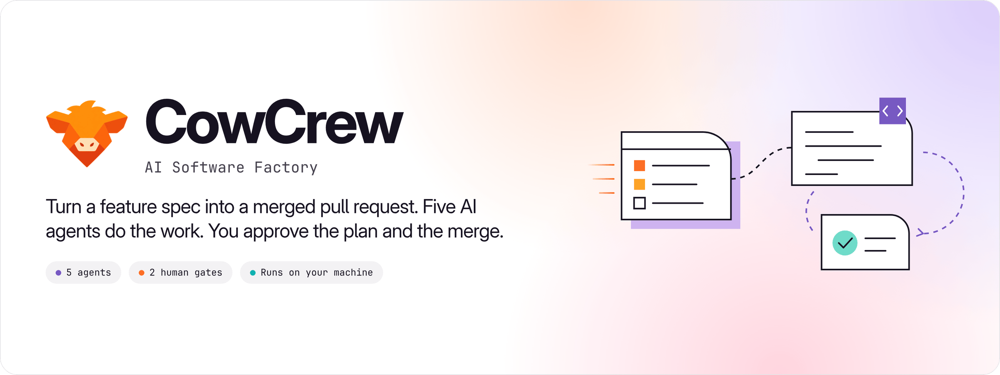
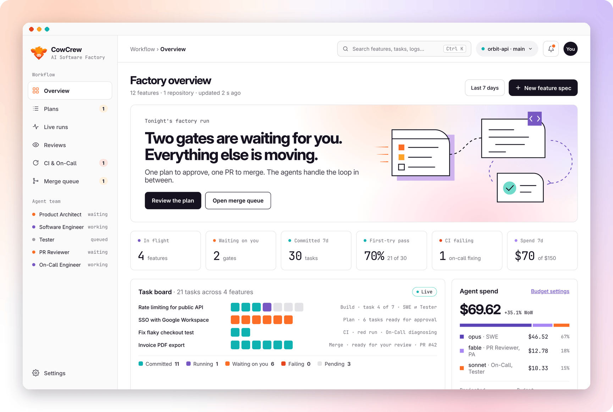
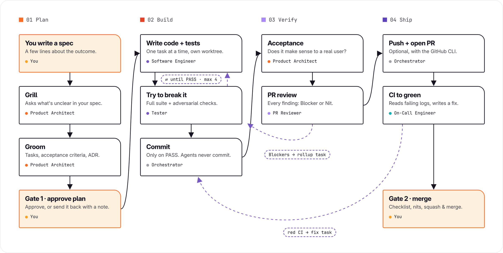
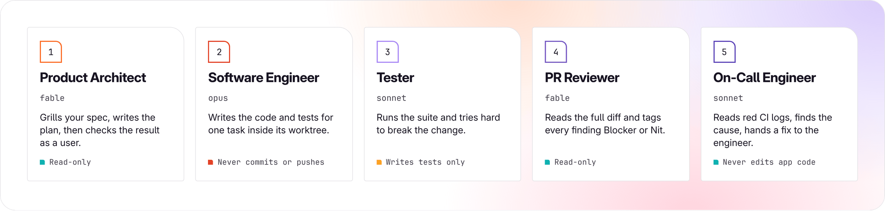
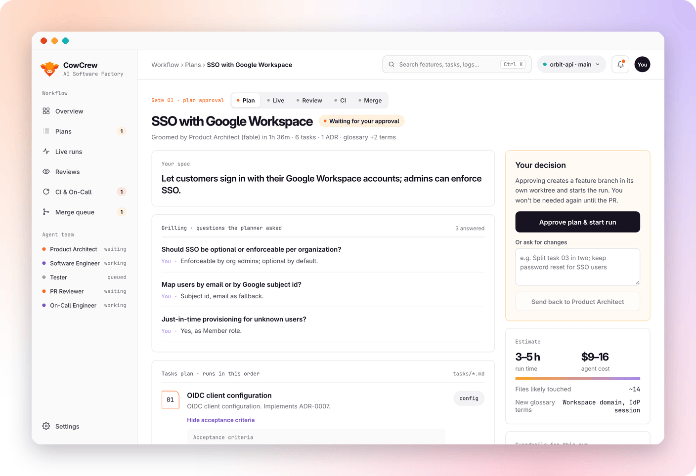
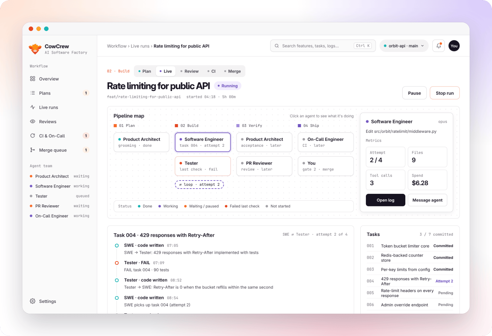
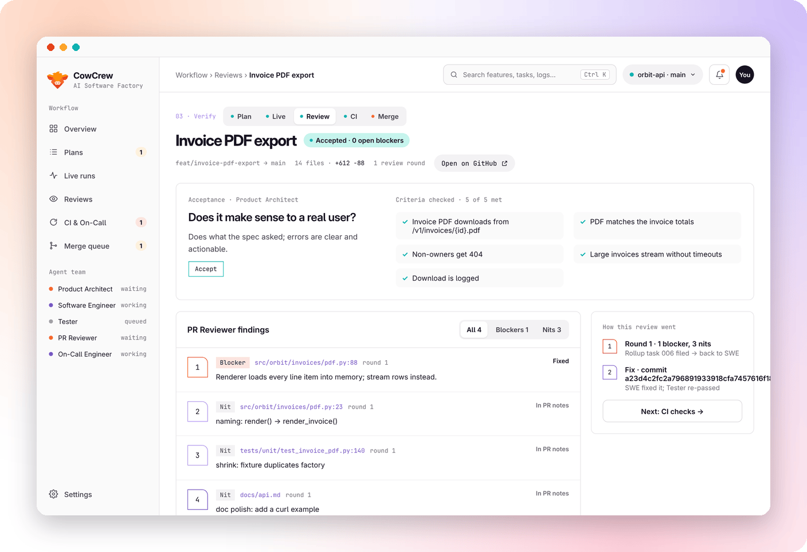
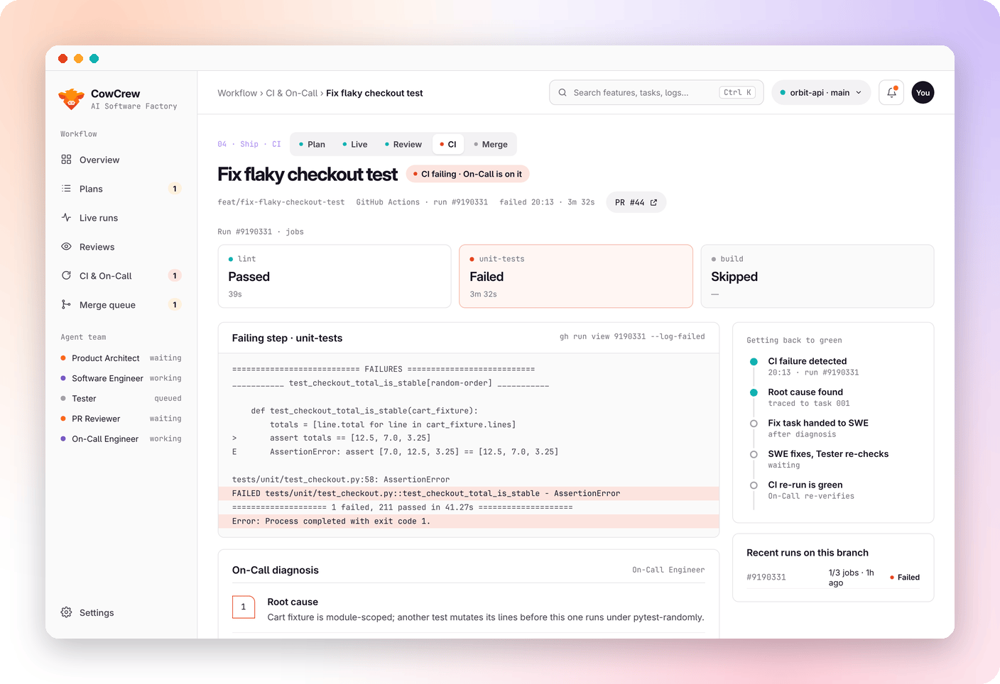
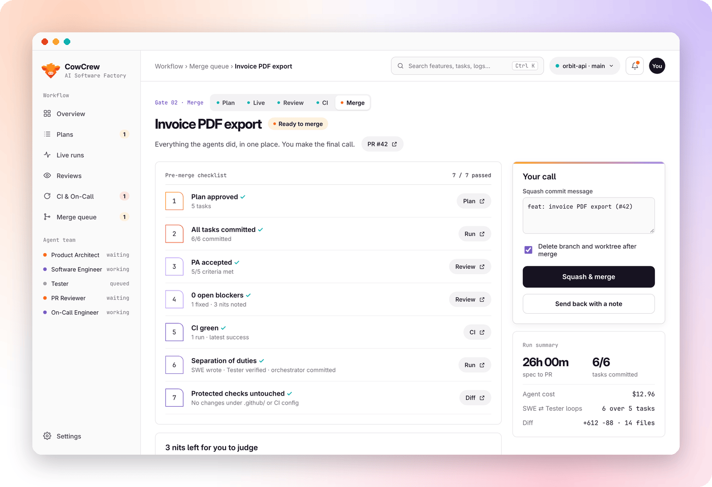
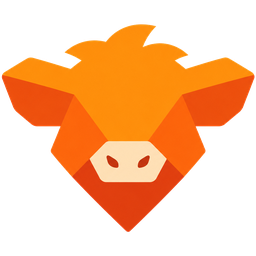

<p align="center">
  
</p>

<p align="center">
  
  
  
  
  
</p>

<p align="center">
  <a href="#quick-start"><b>Quick start</b></a> ·
  <a href="#how-it-works"><b>How it works</b></a> ·
  <a href="#meet-the-crew"><b>The crew</b></a> ·
  <a href="#a-tour-of-the-dashboard"><b>Tour</b></a> ·
  <a href="#safety-guardrails"><b>Safety</b></a>
</p>

<br>

<p align="center">
  
</p>

CowCrew is a software factory that runs on your own computer. You write a few lines about the
feature you want. A crew of five AI agents plans it, builds it task by task, tests it, reviews
it and gets CI green, all inside its own git worktree. You step in exactly twice: to **approve
the plan** and to **merge the result**. A live dashboard shows every agent, every loop and every
dollar while it happens.

<table>
  <tr>
    <td width="33%" valign="top">
      <h3>You stay in charge</h3>
      Two human gates, a pause button on every run, and a note you can leave for any agent.
      Nothing reaches your main branch until you merge it.
    </td>
    <td width="33%" valign="top">
      <h3>Nobody grades their own work</h3>
      The engineer writes, the tester tries to break it, the reviewer tags every finding,
      and only the orchestrator commits.
    </td>
    <td width="33%" valign="top">
      <h3>You see everything</h3>
      A pipeline map, the engineer ⇄ tester loop, live logs, findings, CI diagnoses and
      spend per agent and model, streamed over WebSocket.
    </td>
  </tr>
</table>

## How it works

<p align="center">
  
</p>

1. **Plan.** The Product Architect reads your spec against the repo and asks up to 5 questions.
   Then it writes an ordered task plan with acceptance criteria, at most one ADR, and a time
   and cost estimate. **Gate 1:** you approve it or send it back with a note.
2. **Build.** CowCrew creates a worktree `../<repo>-<slug>` on `feat/<slug>`. For each task, the
   Software Engineer writes code and tests, and the Tester verifies them adversarially. A FAIL
   goes back to the engineer with the Tester's report, up to `max_attempts` times. On PASS,
   the orchestrator commits.
3. **Verify.** The Product Architect checks the feature as a real user would. The PR Reviewer
   reads the full diff and tags each finding Blocker or Nit. Blockers become one rollup task;
   Nits never block.
4. **Ship.** If the project has a GitHub repo and `gh` is logged in, CowCrew pushes, opens the
   PR and watches CI. When CI goes red, the On-Call Engineer diagnoses the failure and writes a
   fix task. **Gate 2:** you read the checklist and squash-merge, through the PR or locally.

Progress is saved in SQLite. After a restart, running features come back paused and pick up
where they left off when you resume them.

## Meet the crew

<p align="center">
  
</p>

Each agent runs on the [Claude Agent SDK](https://docs.claude.com/en/docs/agent-sdk/overview)
with its own instructions, tools and model. You can change the model for each one in
Settings.

## A tour of the dashboard

<table>
  <tr>
    <td width="50%" valign="top">
      
      <p><b>Gate 1 · approve the plan.</b> Your spec, the planner's questions and your answers,
      numbered tasks with acceptance criteria, the ADR and the estimate.</p>
    </td>
    <td width="50%" valign="top">
      
      <p><b>Live run.</b> Click any agent on the pipeline map to see what it's doing. Follow
      the engineer ⇄ tester loop and the live log as they stream in.</p>
    </td>
  </tr>
  <tr>
    <td width="50%" valign="top">
      
      <p><b>Review.</b> The acceptance verdict with each criterion, and every review finding
      tagged Blocker or Nit, with its file and line.</p>
    </td>
    <td width="50%" valign="top">
      
      <p><b>CI &amp; On-Call.</b> Which jobs failed, the failing log, and the On-Call
      diagnosis: root cause, the task responsible and the fix it handed back.</p>
    </td>
  </tr>
  <tr>
    <td width="50%" valign="top">
      
      <p><b>Gate 2 · merge.</b> A seven-point checklist, the nits left for you, and squash
      &amp; merge, with an optional follow-up feature for the nits.</p>
    </td>
    <td width="50%" valign="top">
      <h3>Built for a single developer</h3>
      <p>CowCrew is a local tool: one command, one SQLite file, your own repos on disk. No
      account and no server to host. The UI follows a white, line-art visual identity with
      GitLab Sans and GitLab Mono.</p>
    </td>
  </tr>
</table>

## Quick start

You need Python 3.11+ with [uv](https://docs.astral.sh/uv/), Node 20+ and git.

```bash
git clone https://github.com/cowdex/cowcrew && cd cowcrew
make install     # uv sync + npm ci
make demo        # build the UI, load demo data, serve with simulated agents
```

Open **http://localhost:8787**. The demo runs a simulated crew, so you can click through the
whole flow without an API key.

### Run the real agents

1. Set `ANTHROPIC_API_KEY`, or log in to Claude Code on this machine.
2. Optional: install the [GitHub CLI](https://cli.github.com/) and run `gh auth login` so CowCrew
   can push, open PRs and watch CI.
3. `make serve`, then go to **Settings → Projects** and add a repo by its absolute path (plus
   `owner/repo` if you want PRs).
4. Click **New feature spec**, describe what you want, and follow it through the gates.

Want a guided first run? **[docs/DEMO.md](docs/DEMO.md)** walks you through a full real-agent
scenario on a bundled starter app (`examples/shortly`): a safety drill, a warm-up feature, and a
security-heavy feature that exercises every gate, the tester loop, review Blockers and a red CI
run fixed by On-Call.

| Command      | What it does                                         |
|--------------|------------------------------------------------------|
| `make dev`   | backend with auto-reload on :8787 and Vite on :5173  |
| `make serve` | build the UI and serve everything on :8787           |
| `make seed`  | load the demo project (`orbit-api`)                  |
| `make reset` | wipe the database                                    |
| `make test`  | backend tests and lint                               |

## Safety guardrails

- **Only the orchestrator commits.** Agents can't commit, push, merge, rebase, switch branches
  or run `gh`.
- **Every tool call is checked** by a policy in `guard.py`, run as a PreToolUse hook that fails
  closed plus a `can_use_tool` callback. Nothing is pre-approved, and user and project Claude
  settings aren't loaded.
  - Writes stay inside the feature worktree, with symlinks resolved, and never touch `.git/`,
    `.github/` or other CI config.
  - The Tester can write only under test directories. Read-only agents get no write tools.
  - Reads stay inside the worktree and skip `.env` secrets.
  - Bash can't use `sudo`, `ssh`/`scp`, `curl … | sh`, `cd` out of the worktree, or `rm`,
    redirect or copy outside the agent's write scope.
  - Every blocked call shows up in the live log as `Blocked: …`.
- **A weekly budget** pauses the pipeline when spend reaches it.
- **The server binds to 127.0.0.1** and rejects cross-site writes, cross-site WebSockets and
  unknown `Host` headers (DNS rebinding). It never logs secrets.

> [!IMPORTANT]
> The Bash check is a guard rail for well-behaved agents, not a sandbox. Only point CowCrew at
> repos you trust, or run it in a container or VM.

<details>
<summary><b>Simulate mode</b></summary>
<br>

Simulate mode is on when `COWCREW_SIMULATE=1` is set or no credentials are found. A simulator
replaces the agents and streams realistic events: a Tester FAIL followed by a PASS, a review
Blocker, and a red CI run followed by a green one. A whole feature takes about a minute.

If the project is a real git repo, simulate mode still does the real local git work: the
worktree, the commits and the squash merge. It never pushes and never opens a real PR.
</details>

<details>
<summary><b>Configuration</b></summary>
<br>

| Variable                     | Default         | Meaning                                                 |
|------------------------------|-----------------|---------------------------------------------------------|
| `ANTHROPIC_API_KEY`          | —               | API key for the agents (or log in to Claude Code)       |
| `COWCREW_HOME`               | `~/.cowcrew`    | Where `cowcrew.db` lives                                |
| `COWCREW_SIMULATE`           | auto            | `1` forces simulate mode                                |
| `COWCREW_BILLING`            | auto            | `subscription` shows tokens, `api` shows dollars        |
| `COWCREW_PORT`               | `8787`          | Port for `cowcrew serve`                                |
| `COWCREW_SIM_SPEED`          | `1`             | Multiplier for simulated delays (`0` = instant)         |
| `COWCREW_CI_POLL_SECONDS`    | `20`            | How often CI is polled                                  |
| `COWCREW_CI_TIMEOUT_SECONDS` | `2700`          | When a CI wait gives up and pauses                      |
| `COWCREW_FRONTEND_DIST`      | `frontend/dist` | Built UI to serve                                       |

Budget, `max_attempts` and the model for each agent are set on the Settings page. On a Claude
subscription, CowCrew shows usage and the weekly budget in **tokens**. With an API key, it shows
**dollars**.
</details>

<details>
<summary><b>Project layout</b></summary>
<br>

```
backend/    FastAPI app, orchestrator, Agent SDK runner, guard, git and gh helpers, tests
frontend/   React + Vite + TypeScript dashboard
docs/       API contract (CONTRACT.md) and README assets
```
</details>

## Credits

CowCrew adapts the agent contracts of [Squid](https://github.com/iusztinpaul/squid) by Paul
Iusztin (Apache-2.0); see [NOTICE](NOTICE). The interface uses
[GitLab Sans and GitLab Mono](https://gitlab.com/gitlab-org/frontend/fonts) (SIL Open Font
License).

<br>
<p align="center">
  <br>
  <sub><b>CowCrew</b> · AI Software Factory</sub>
</p>
